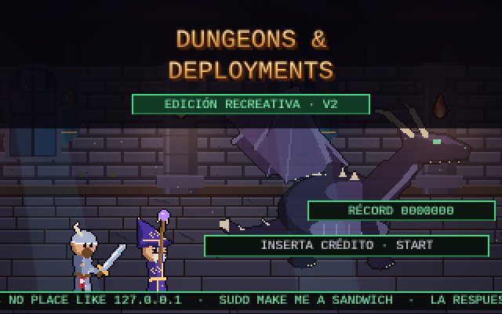
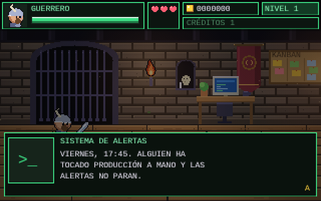
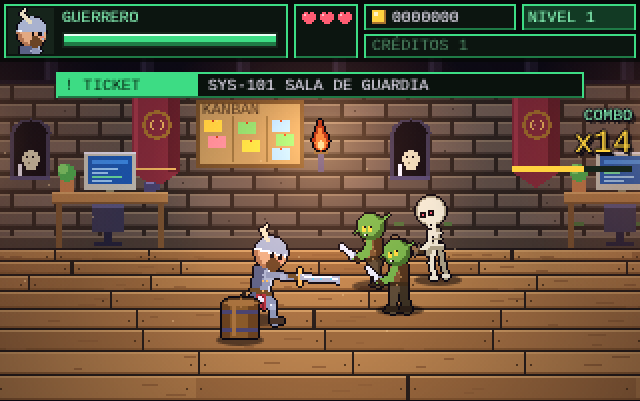
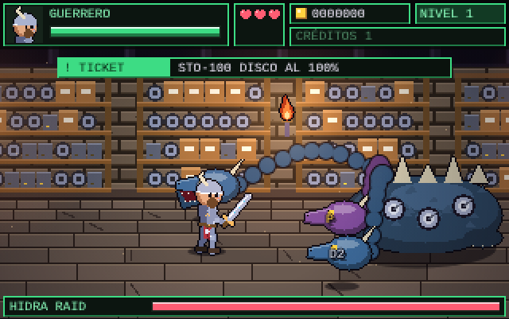
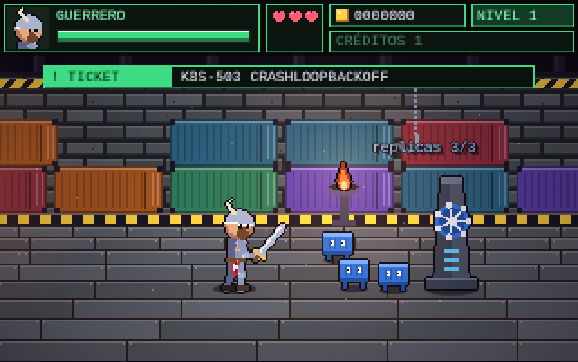
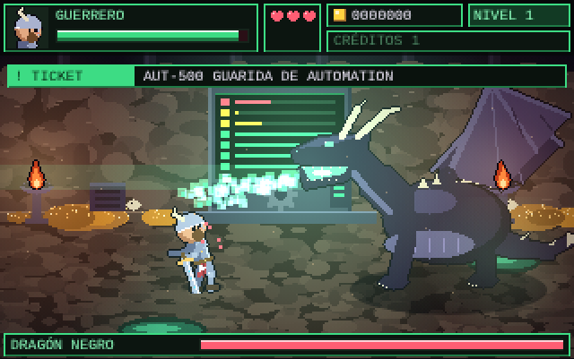
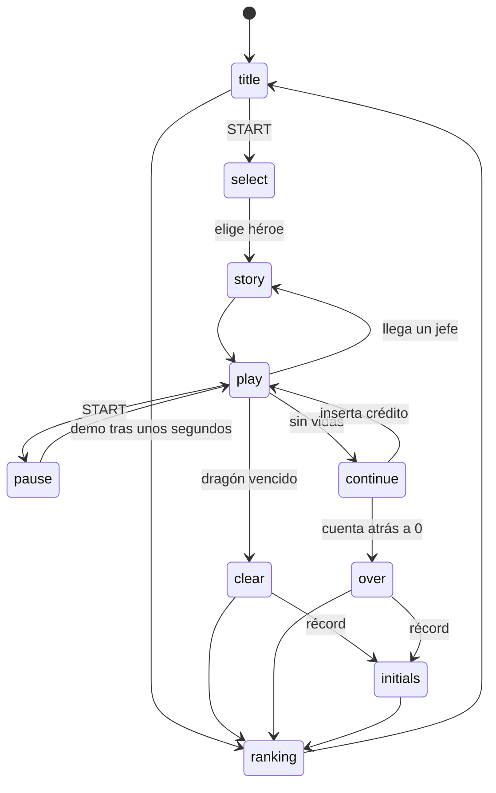

# Dungeons & Deployments

[](https://github.com/serbenda/dungeons-and-deployments/actions/workflows/ci.yml)

Beat 'em up de fantasía en pixel art en el que un equipo de desarrollo se abre camino por las catacumbas del CPD: de los goblins del ClickOps al Dragón Negro que se ha adueñado de la Guarida de Automation.

HTML5, canvas y JavaScript puro, sin dependencias ni paso de compilación. Todos los gráficos y la música se generan por código.

**Jugar:** https://serbenda.github.io/dungeons-and-deployments/



## Índice

- [El juego](#el-juego)
- [Controles](#controles)
- [Desarrollo en local](#desarrollo-en-local)
- [Estructura del proyecto](#estructura-del-proyecto)
- [Arquitectura](#arquitectura)
- [Guías rápidas](#guías-rápidas)
- [Pruebas](#pruebas)
- [Despliegue en GitHub Pages](#despliegue-en-github-pages)
- [Flujo de trabajo](#flujo-de-trabajo)

## El juego

Viernes, 17:45. Alguien ha tocado producción a mano. Elige personaje y cierra el ticket de cada departamento antes del fin de semana.

| Personaje | Estilo | Especial |
|---|---|---|
| **Guerrero de Rundeck** | Lento y pegón, espada con runas | `RUN JOB`: golpe al suelo que tumba a todos |
| **Mago Desarrollador** | Rápido, el remate lanza un `console.log()` | `GIT PUSH -F`: explosión arcana |

| Zona | Ticket | Enemigos | Jefe |
|---|---|---|---|
| Sistemas | `SYS-101` Sala de guardia | Goblins del ClickOps, procesos zombi | |
| Network | `NET-404` Paquetes perdidos | Murciélagos de paquetes perdidos, Caballero Firewall | Minotauro del Firewall |
| Storage | `STO-100` Disco al 100% | Mímicos de disco lleno, fugas de memoria | Hidra RAID |
| Virtualización | `VIR-007` VMs huérfanas | VMs huérfanas fantasma, Gólem Hipervisor | |
| CaaS | `K8S-503` CrashLoopBackOff | Pods que reaparecen hasta destruir el Deployment | |
| Automation | `AUT-500` Guarida de Automation | | Dragón Negro |

| | |
|---|---|
|  |  |
|  |  |
|  |  |

Además: música chiptune por departamento, combos con rangos (`NICE!` … `ARQUITECTO`), viñetas de historia, ranking con iniciales, botín geek (el patito de goma, el pergamino de Stack Overflow…) y un código secreto en la pantalla de título.

## Controles

| Teclado | Táctil | Acción |
|---|---|---|
| Flechas / WASD | Cruceta | Moverse (arriba y abajo para la profundidad) |
| Z · J · Espacio | A | Atacar (combo de 3), coger objetos, pasar diálogos |
| X · K | B | Saltar; atacar en el aire para la patada |
| C · L | SP | Especial (cuesta 10 de vida) |
| Enter | START | Insertar crédito, empezar, pausa |
| M | | Silenciar música y sonido |

## Desarrollo en local

No hace falta instalar nada para jugar ni para editar:

```bash
git clone https://github.com/serbenda/dungeons-and-deployments.git
cd dungeons-and-deployments
```

Abre `index.html` en el navegador o, mejor, sírvelo por HTTP para trabajar igual que en GitHub Pages:

```bash
python3 -m http.server 8000
# http://localhost:8000/
```

Para las pruebas automáticas necesitas Node.js 18 o superior (ver [Pruebas](#pruebas)).

## Estructura del proyecto

```
.
├── index.html               Página: lienzo, mandos táctiles y ficha del juego
├── css/
│   └── styles.css           Estilos de la página (no del juego)
├── js/                      Código del juego, cargado en este orden
│   ├── core/
│   │   ├── config.js        Canvas, resolución (320×200), paleta y fuentes
│   │   ├── pixel.js         Motor de pixel art y caché de sprites
│   │   ├── input.js         Teclado, mandos táctiles y código Konami
│   │   └── utils.js         Partículas, textos flotantes y colisiones
│   ├── sprites/
│   │   ├── characters.js    Personajes articulados y sus poses
│   │   └── monsters.js      Gólem, dragón, objetos y enemigos no humanoides
│   ├── world/
│   │   └── level.js         Mazmorra prerenderizada, decorado e iluminación
│   ├── data/
│   │   └── game-data.js     Héroes, enemigos, comida, secciones y cajas
│   ├── audio/
│   │   ├── sfx.js           Efectos de sonido (WebAudio)
│   │   └── music.js         Secuenciador chiptune y temas
│   ├── game/
│   │   ├── state.js         Estado de la partida, enemigos y oleadas
│   │   ├── combat.js        Daño, combos, derribos y bloqueos
│   │   └── loop.js          Máquina de estados y actualización por fotograma
│   ├── entities/
│   │   ├── player.js        Control del jugador
│   │   ├── enemies.js       IA de enemigos, gólem y Dragón Negro
│   │   └── bosses.js        Minotauro del Firewall e Hidra RAID
│   ├── ui/
│   │   ├── story.js         Viñetas de historia
│   │   └── ranking.js       Ranking con iniciales
│   ├── render/
│   │   └── draw.js          Dibujo de actores, HUD y pantallas
│   └── main.js              Arranque y modo depuración
├── tools/
│   └── smoke-test.js        Prueba de humo con un bot que juega la etapa
├── docs/                    Capturas del README
└── .github/                 CI, despliegue a Pages y plantilla de PR
```

## Arquitectura

### Carga de scripts

El juego usa **scripts clásicos** (no módulos ES) que comparten el ámbito global, así funciona tanto en GitHub Pages como abriendo `index.html` con `file://`. Cada archivo empieza con `'use strict'`.

El orden de los `<script>` en `index.html` importa: un archivo solo puede usar **al cargarse** lo que declaran los anteriores. Dentro de funciones se puede usar cualquier cosa, porque se ejecutan cuando ya está todo cargado. Por eso `js/main.js` va el último: es el único que arranca el juego.

### Bucle y estados

`js/main.js` ejecuta un bucle de paso fijo: `update()` corre 60 veces por segundo y `draw()` una vez por fotograma de pantalla. `update()` (en `js/game/loop.js`) despacha según la variable global `state`:



### Coordenadas

- `x`: posición horizontal en el mundo (la etapa mide `LEVEL_END + 320` píxeles). La cámara es `camX`.
- `y`: profundidad, entre `FY0` y `FY1`. Dos actores solo chocan si su `y` es parecida. Los actores se dibujan ordenados por `y`.
- `z`: altura sobre el suelo (saltos, vuelos, derribos).

### Secciones y tickets

La etapa avanza por las secciones de `SECTIONS` (`js/data/game-data.js`). Cuando la cámara llega a `cam`, la pantalla se bloquea, aparece el ticket `mission` y salen las oleadas `waves`. Con todas limpias (y el jefe `miniboss`, si lo hay) se muestra `close` y se desbloquea el avance.

### Gráficos

No hay imágenes: todo se pinta por código.

- `painter(w, h)` (`js/core/pixel.js`) da primitivas de píxel: `px`, `rect`, `disc`, `ell`, `line`, `poly`.
- `sprite(clave, w, h, fn)` pinta una vez, añade el contorno oscuro y una versión blanca para el destello de golpe, y lo guarda en caché por `clave`.
- Los humanoides usan un **esqueleto articulado** (`RIGS` y `POSES` en `js/sprites/characters.js`). Una pose como `'walk0~walk1~0.5'` es la mezcla al 50 % de dos poses: así salen los fotogramas intermedios.
- La mazmorra se pinta una sola vez en un lienzo grande (`buildLevel`) y cada fotograma se recorta la parte visible. Las luces se suman encima con `globalCompositeOperation = 'lighter'`.

### Sonido

Todo se sintetiza con WebAudio. `sfx(nombre)` lanza efectos cortos. `MUSIC` es un secuenciador por pasos de semicorchea: cada tema define tempo, escala, progresión de acordes, motivos de melodía, bajo y percusión. `musicFor()` elige el tema según el estado y la zona.

## Guías rápidas

**Añadir un enemigo**
1. Define sus datos en `FOES` (`js/data/game-data.js`): `hp`, `spd`, `dmg`, `wind`, `score` y `rig` si es humanoide.
2. Si es humanoide, añade su esqueleto en `RIGS`. Si no, crea su sprite en `js/sprites/monsters.js` y un caso en `drawActor` (`js/render/draw.js`).
3. Añade su `kind` a `GRUNTS` (`js/core/utils.js`) para que cuente como enemigo de la oleada.
4. Si necesita IA propia, enrútala al principio de `updateFoe` (`js/entities/enemies.js`).
5. Ponlo en alguna oleada de `SECTIONS`.

**Añadir una sección o ticket:** añade una entrada a `SECTIONS` con `cam`, `mission`, `close` y `waves`. Cada oleada es una lista de `[tipo, lado]`, donde el lado es `1` (derecha), `-1` (izquierda) o `0` (sale del suelo).

**Añadir un diálogo:** añade una entrada a `STORIES` (`js/ui/story.js`) y llama a `startStory('clave', callback)`.

**Añadir un tema musical:** añade una entrada a la tabla `T` de `js/audio/music.js` y devuélvela desde `musicFor()`.

### Modo depuración

Abre `index.html?debug` y tendrás `window.dnd` en la consola, con acceso al estado de la partida:

```js
dnd.P.hp = 100;      // vida al máximo
dnd.state            // estado actual
dnd.foes             // enemigos en pantalla
```

## Pruebas

`tools/smoke-test.js` abre el juego en Chromium sin ventana, comprueba que no hay errores y deja que un bot juegue la etapa entera con los dos héroes, en modo invulnerable y en modo normal.

```bash
npm install
npx playwright install chromium
npm test                                   # sobre file://
BASE_URL=http://localhost:8000/ npm test   # contra un servidor
npm run check                              # solo comprueba la sintaxis
```

La CI ejecuta las dos comprobaciones en cada push y en cada PR.

## Despliegue en GitHub Pages

El workflow `.github/workflows/pages.yml` publica el juego en cada push a `main`. Para activarlo una sola vez: *Settings → Pages → Build and deployment → Source: GitHub Actions*.

Todas las rutas son relativas, así que funciona igual en `https://serbenda.github.io/dungeons-and-deployments/` que en local.

## Flujo de trabajo

- `main`: lo publicado en GitHub Pages.
- `development`: integración. Las funcionalidades nuevas se trabajan aquí o en ramas `feature/...` que salen de `development`.
- Se fusiona a `main` mediante Pull Request, con la CI en verde.

Más detalles en [CONTRIBUTING.md](CONTRIBUTING.md) y los cambios de cada versión en [CHANGELOG.md](CHANGELOG.md).
