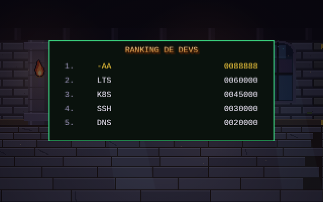

# Dungeons & Deployments

Beat 'em up de fantasía en pixel art en el que un equipo de desarrollo se abre camino por las catacumbas del CPD: de los goblins del ClickOps al Dragón Negro que se ha adueñado de la Guarida de Automation.

Es un único archivo HTML con canvas y JavaScript, sin dependencias ni compilación. Se juega en el navegador, con teclado o con los mandos táctiles en el móvil.

## Jugar

Abre [`index.html`](index.html) en el navegador.

Con GitHub Pages activado, el juego queda en `https://serbenda.github.io/dungeons-and-deployments/`.

## Personajes

| Personaje | Estilo | Especial |
|---|---|---|
| **Guerrero de Rundeck** | Lento y pegón, espada con runas | `RUN JOB`: golpe al suelo que tumba a todos |
| **Mago Desarrollador** | Rápido, el remate lanza un `console.log()` | `GIT PUSH -F`: explosión arcana |

## La etapa

Viernes, 17:45. Alguien ha tocado producción a mano. Hay que cerrar el ticket de cada departamento antes del fin de semana.

| Zona | Ticket | Enemigos | Jefe |
|---|---|---|---|
| Sistemas | `SYS-101` Sala de guardia | Goblins del ClickOps, procesos zombi | |
| Network | `NET-404` Paquetes perdidos | Murciélagos de paquetes perdidos, Caballero Firewall | **Minotauro del Firewall** |
| Storage | `STO-100` Disco al 100% | Mímicos de disco lleno, fugas de memoria | **Hidra RAID** |
| Virtualización | `VIR-007` VMs huérfanas | VMs huérfanas fantasma, Gólem Hipervisor | |
| CaaS | `K8S-503` CrashLoopBackOff | Pods que reaparecen hasta destruir el Deployment | |
| Automation | `AUT-500` Guarida de Automation | | **Dragón Negro** |

| | |
|---|---|
|  |  |
|  |  |
|  |  |

### Los jefes

- **Minotauro del Firewall:** hachazos, embestidas (`SYN FLOOD`) y una tormenta de broadcast que invoca paquetes perdidos. A media vida levanta `ACL: DENY ALL` y solo se le puede golpear por la espalda.
- **Hidra RAID:** tres cabezas, Disco 1, Disco 2 y Paridad, cada una en un carril. Las de disco se reconstruyen (`RAID REBUILD`) mientras viva la de paridad, que además escupe sectores defectuosos.
- **Dragón Negro:** aliento de ácido en línea recta, mordisco, coletazo si te pones detrás y, por debajo del 65 % de vida, vuelo con pisotón. A media vida llama a refuerzos.

## Controles

| Tecla | Acción |
|---|---|
| Flechas / WASD | Moverse (arriba y abajo para la profundidad) |
| Z · J · Espacio | Atacar (combo de 3), coger armas y comida, pasar diálogos |
| X · K | Saltar; atacar en el aire para la patada |
| C · L | Especial (cuesta 10 de vida) |
| Enter | Insertar crédito, empezar, pausa |
| M | Silenciar música y sonido |

Camina contra un enemigo para agarrarlo: dos rodillazos y al tercero lo lanzas contra los demás.

## Detalles

- Música chiptune propia para cada departamento y un tema para los jefes que acelera a media vida.
- Viñetas de historia al empezar, antes de cada jefe y al terminar.
- Contador de combo con rangos: `NICE!`, `CLEAN CODE`, `10X DEVELOPER`, `SENIOR` y `ARQUITECTO`.
- Ranking de los 5 mejores con iniciales, como en las recreativas, guardado en el navegador.
- Botín: poción de café, pollo asado, tortilla, bocata de calamares, Báculo de Ping, Martillo de Teclas, el patito de goma y el pergamino de Stack Overflow.
- Hay un código secreto en la pantalla de título. La marquesina da una pista.

## Otros juegos

¿Prefieres una aventura de 8 bits con vista cenital? [Deploy Quest](https://github.com/serbenda/deploy-quest) recorre las Catacumbas de Sistemas con el Escudo de IaC y el Grimorio de la Definition of Done.
