<div align="center">

# 🐉 Dungeons & Deployments

**Un beat 'em up de fantasía en pixel art en el que un equipo de desarrollo<br>se abre camino por las catacumbas del CPD, las cuevas del Mainframe y la nube.**

[](https://github.com/serbenda/dungeons-and-deployments/actions/workflows/ci.yml)
[](https://github.com/serbenda/dungeons-and-deployments/actions/workflows/pages.yml)


### [▶ Jugar ahora](https://serbenda.github.io/dungeons-and-deployments/)

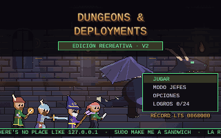

</div>

---

> Viernes, 17:45. Alguien ha tocado producción a mano y las alertas no paran.<br>
> Elige al **Guerrero de Rundeck**, al **Mago Desarrollador**, a la **Pícara del Frontend** o al **Bardo Scrum Master** (o a dos, en cooperativo), cierra el ticket de cada departamento y derrota al **Dragón Negro** antes del fin de semana. Y si llegas sin continuar, prepárate para **El Revisor**.
>
> Lunes, 03:00. Un batch nocturno sale de **Las Cuevas**, donde nadie baja desde 1987. Al fondo te espera el **Lich COBOL**.
>
> Fin de mes. Llega el correo de facturación: sube a **La Nube** y enfréntate a **La Factura de Fin de Mes**.

## Índice

- [Características](#características)
- [Cómo se juega](#cómo-se-juega)
- [Capturas](#capturas)
- [Inicio rápido para desarrolladores](#inicio-rápido-para-desarrolladores)
- [Tecnología](#tecnología)
- [Estructura del proyecto](#estructura-del-proyecto)
- [Documentación](#documentación)
- [Calidad y CI](#calidad-y-ci)
- [Hoja de ruta](#hoja-de-ruta)
- [Contribuir](#contribuir)

## Características

| | |
|---|---|
| 👥 **Cooperativo para dos** | Teclado compartido, dos mandos o teclado y mando. El segundo jugador se une en cualquier momento pulsando START |
| 🦸 **Cuatro héroes** | Guerrero de Rundeck, Mago Desarrollador, Pícara del Frontend y Bardo Scrum Master, cada uno con su especial |
| 🎮 **Recreativa de verdad** | Combos de 3 golpes, saltos y patadas, agarres y lanzamientos, especiales que cuestan vida, armas con usos limitados y comida escondida en barriles |
| 🗺️ **Tres etapas** | **Las Catacumbas**: Sistemas, Network, Storage, Virtualización y CaaS. **Las Cuevas**: Bases de datos, Seguridad y Monitorización. **La Nube**: Kubernetes, Serverless y Facturación. Cada zona con su decorado, sus enemigos, su música y su ticket (`NET-404`, `SEC-666`, `FIN-402`...) |
| 👹 **Diez jefes** | Minotauro del Firewall (`ACL: DENY ALL`), Hidra RAID (paridad), Dragón Negro, Troll DBA (`LOCK TABLE`), Cancerbero de las 3 AAA (MFA), Lich COBOL (copia en cinta), Kraken del Clúster (control plane), Autoescalador (`SCALE OUT`), la Factura de Fin de Mes (lluvia de cargos) y El Revisor, jefe secreto que no deja pasar nada sin la Definition of Done |
| 🤓 **Humor geek** | Goblins del ClickOps, VMs huérfanas, pods en CrashLoopBackOff, consultas N+1, cofres phishing, ransomware, falsos positivos a las 3:00, YAML mal indentado, lambdas en frío, NAT Gateways, «SIEMPRE ES EL DNS», el patito de goma y el pergamino de Stack Overflow |
| 🎨 **Pixel art generado por código** | Personajes articulados con animación interpolada, mazmorra con iluminación dinámica. Ni una sola imagen |
| 🎵 **Banda sonora chiptune** | Un tema original por departamento, sintetizado en directo con Web Audio |
| 🕹️ **Mandos** | Xbox, PlayStation y cualquier mando estándar por USB o Bluetooth |
| 📱 **Móvil y tableta** | Cruceta analógica, botones grandes, pantalla completa, vibración y diseño vertical u horizontal |
| ⚙️ **Opciones** | Volumen de música y efectos, tres dificultades, modo sin destellos, vibración y **teclas reasignables** |
| ⚔️ **Modo jefes** | Los nueve jefes de las tres etapas seguidos, contra el reloj y con su propio ranking |
| 🏅 **24 logros** | «SIEMPRE ES EL DNS», «PAIR PROGRAMMING», «SIN ROLLBACK»... y créditos finales con las estadísticas de la partida |
| 📶 **Sin conexión** | PWA instalable: se añade a la pantalla de inicio y funciona sin internet |
| 🏆 **Ranking** | Top 5 con iniciales, como en los salones recreativos |

## Cómo se juega

| Teclado | Mando | Móvil | Acción |
|---|---|---|---|
| ←↑→↓ / WASD | Cruceta o stick | Cruceta | Moverse (arriba y abajo cambian de carril) |
| Z · J · Espacio | A · ✕ | **A** | Atacar (combo de 3), coger objetos |
| X · K | B · ○ | **B** | Saltar (A en el aire: patada) |
| C · L | X · Y · □ · △ | **SP** | Especial: cuesta 10 de vida |
| Enter | START | START | Empezar, pausa, insertar crédito |
| M | SELECT | SONIDO | Silenciar |

Las teclas del jugador 1 se pueden cambiar en **Opciones › TECLAS**.

**Dos jugadores:** pulsa **2** en el teclado o **START** en un mando, en la selección o en plena partida. En un mismo teclado, el jugador 1 usa flechas, Z, X, C y Enter, y el jugador 2, WASD, J, K y L.

**Trucos:** camina contra un enemigo para agarrarlo y lánzalo contra los demás. Al Firewall, por la espalda. A la Hidra, primero la paridad. Y hay un código secreto en la pantalla de título.

Todos los números del juego (vida, daño, puntos) están en el [documento de diseño](docs/diseno-del-juego.md).

## Capturas

| | |
|---|---|
| 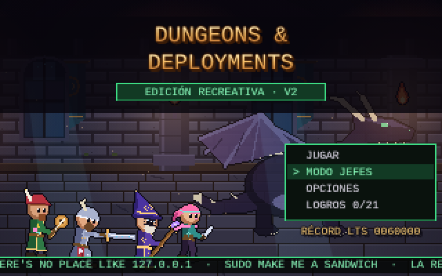 | 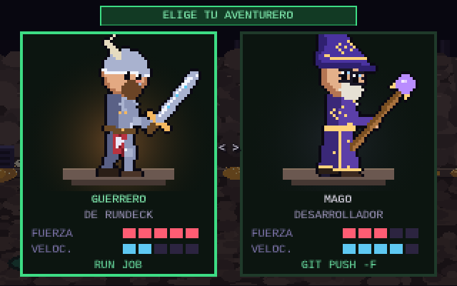 |
| 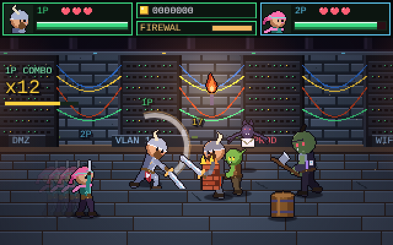 | 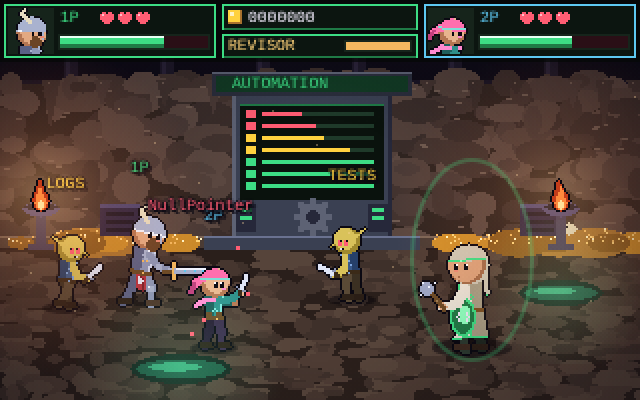 |
|  | 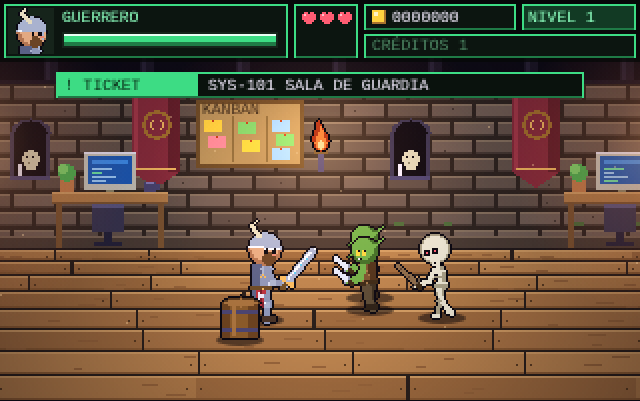 |
| 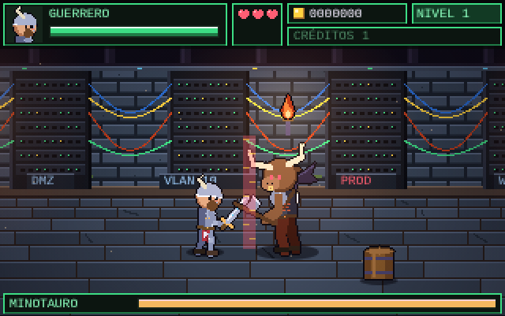 |  |
|  | 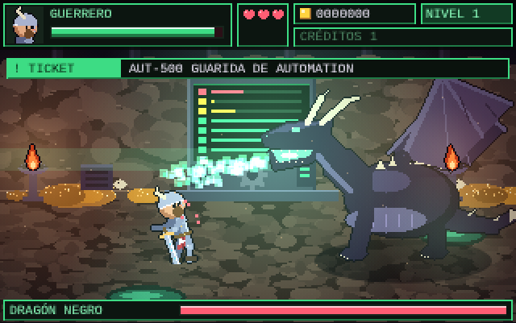 |
| 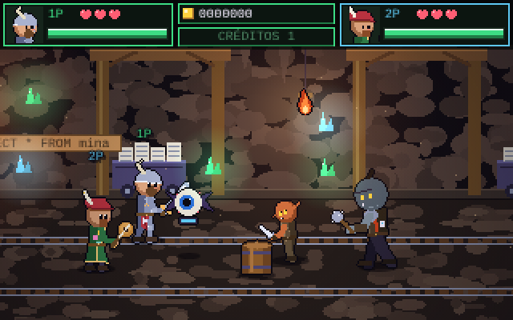 | 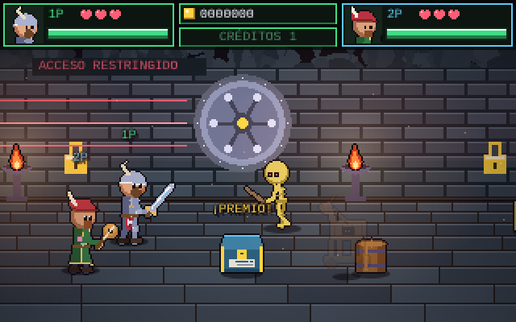 |
| 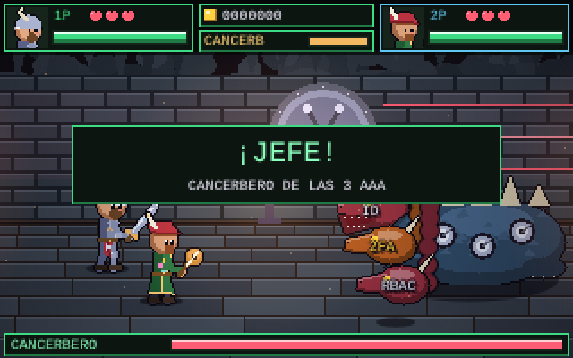 | 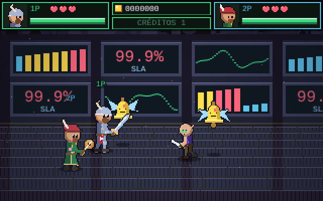 |
| 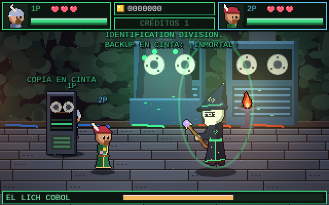 | 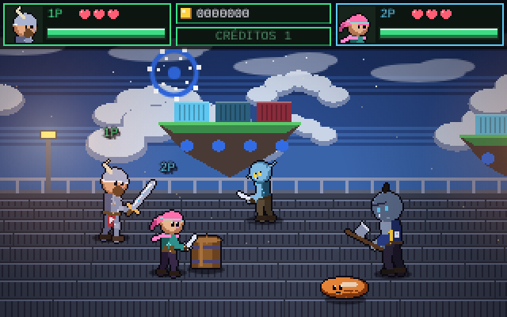 |
| 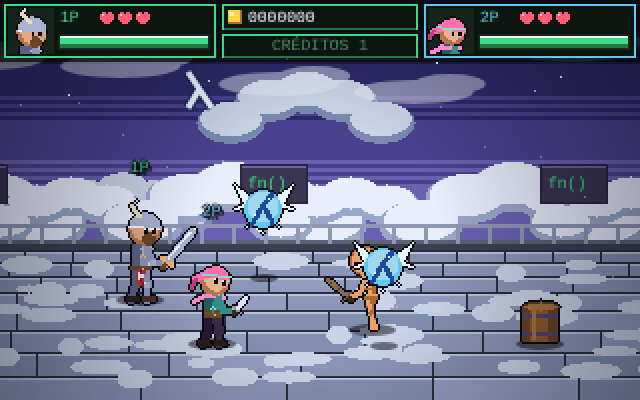 | 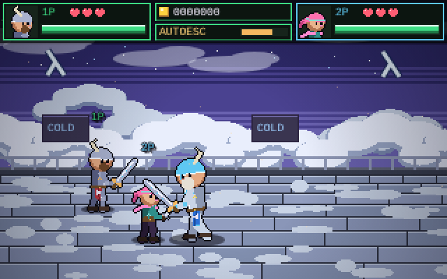 |
| 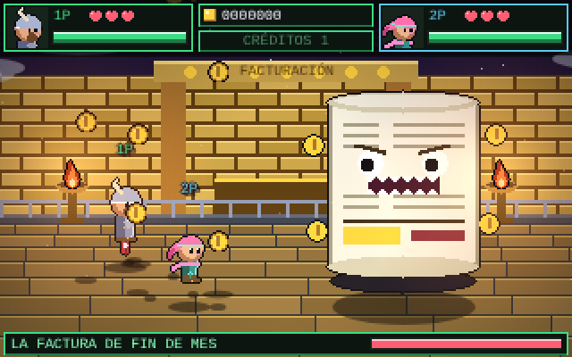 | 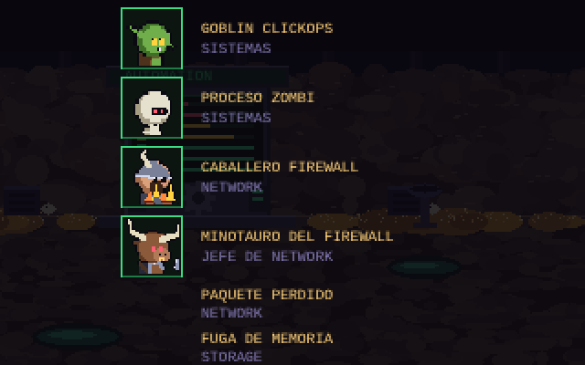 |
| 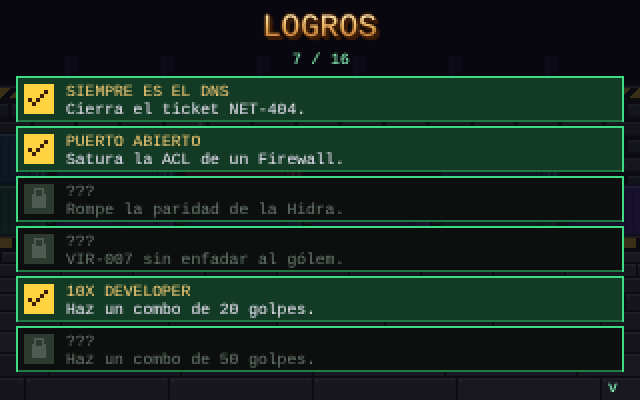 | 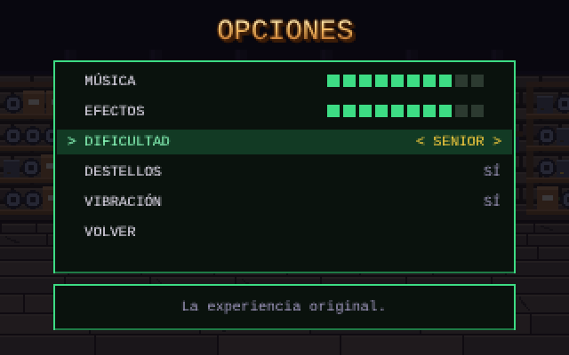 |
| 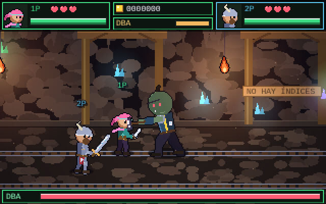 | 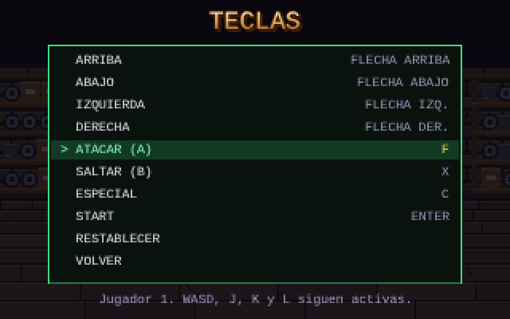 |

<div align="center">

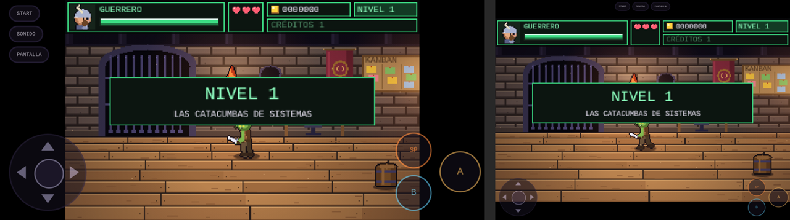

</div>

## Inicio rápido para desarrolladores

**Jugar en local** no necesita instalar nada:

```bash
git clone https://github.com/serbenda/dungeons-and-deployments.git
cd dungeons-and-deployments
python3 -m http.server 8000        # o abre index.html directamente
```

Y abre http://localhost:8000/. Para probar el modo táctil en el ordenador: http://localhost:8000/?touch.

**Desarrollar con pruebas** (Node.js 20 o superior):

```bash
npm install
npx playwright install chromium

npm run lint        # estructura del proyecto + ESLint
npm test            # pruebas unitarias (sin navegador, ~3 s)
npm run test:e2e    # un bot juega la etapa completa en Chromium
```

**Depurar:** abre `index.html?debug&seed=42` y tendrás `window.dnd` en la consola, con una partida reproducible.

```js
dnd.P.hp = 100;        // vida al máximo
camX = 2600;           // saltar a la Forja de contenedores
spawnHydra(camX + 262) // invocar a la Hidra RAID
```

## Tecnología

- **HTML5 Canvas 2D** a 320×200, escalado sin suavizado.
- **JavaScript puro** (ES2022) en scripts clásicos: sin dependencias, sin empaquetador, sin compilación.
- **Motor de pixel art propio**: pintor por píxeles, contorno automático, caché de sprites y esqueletos con poses interpoladas.
- **Web Audio API**: efectos sintetizados y secuenciador chiptune.
- **PWA**: manifest y service worker (primero la red, caché sin conexión).
- **Gamepad API** para mandos.
- **Pointer Events, Fullscreen, Vibration y Screen Wake Lock** para móvil.
- **Node.js** solo para desarrollo: `node:test`, ESLint 9 y Playwright.
- **GitHub Actions** para CI y despliegue en GitHub Pages.

## Estructura del proyecto

```
├── index.html              Página y orden de carga de los scripts
├── manifest.webmanifest    PWA: nombre, iconos, pantalla completa
├── sw.js                   Service worker (juego sin conexión)
├── css/styles.css          Estilos de la página y de los mandos táctiles
├── img/                    Iconos y vista previa para redes sociales
├── js/
│   ├── core/               Configuración, motor de píxeles, teclado, mandos, táctil y utilidades
│   ├── sprites/            Personajes articulados y monstruos (de cada etapa)
│   ├── world/              Mazmorra, Las Cuevas, La Nube e iluminación
│   ├── data/               Héroes, enemigos, objetos y secciones
│   ├── audio/              Efectos y música
│   ├── game/               Estado, combate y bucle
│   ├── entities/           Jugador, enemigos y jefes
│   ├── ui/                 Historia, ranking, opciones, logros y créditos
│   ├── render/             Dibujo, HUD y pantallas
│   └── main.js             Arranque
├── tests/                  Pruebas unitarias (node:test)
├── tools/                  Lint del proyecto y prueba de humo
├── docs/                   Documentación técnica y capturas
└── .github/                CI, despliegue, Dependabot y plantillas
```

Cada archivo empieza con una línea que resume su contenido, y cada función y tabla de datos tiene su comentario JSDoc.

## Documentación

| Guía | Contenido |
|---|---|
| [Arquitectura](docs/arquitectura.md) | Carga de scripts, bucle de paso fijo, máquina de estados, coordenadas y secciones |
| [Diseño del juego](docs/diseno-del-juego.md) | Héroes, enemigos, jefes, etapa, objetos y puntuación, con todos los números |
| [Gráficos](docs/graficos.md) | Motor de píxeles, esqueletos y poses, mazmorra e iluminación |
| [Audio](docs/audio.md) | Efectos y formato de los temas del secuenciador |
| [Controles, móvil y PWA](docs/controles-y-movil.md) | Teclas lógicas, cruceta analógica, disposición táctil e instalación |
| [Recetas](docs/recetas.md) | Paso a paso: enemigos, jefes, secciones, objetos, diálogos, temas y héroes |
| [Pruebas](docs/pruebas.md) | Lint, pruebas unitarias, prueba de humo, semillas y modo depuración |
| [Despliegue y versiones](docs/despliegue-y-versiones.md) | Ramas, CI, GitHub Pages, caché de la PWA y publicación de versiones |

## Calidad y CI

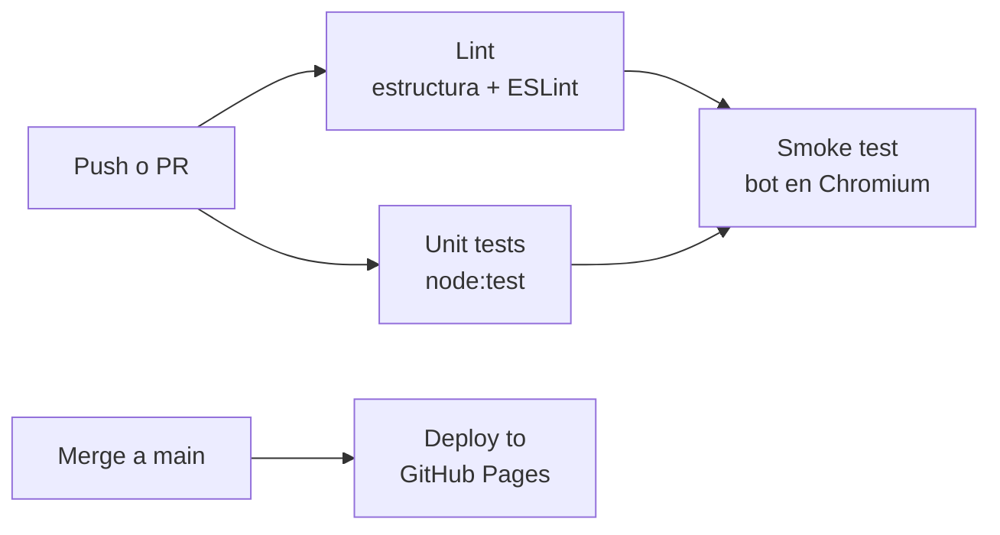

- **Lint**: sintaxis, orden de carga, coherencia entre `index.html`, el service worker y el manifest, y ESLint.
- **Unit tests**: datos, poses, combos, jefes, ranking, semillas y música, cargando el juego en un contexto aislado.
- **Smoke test**: un bot juega las tres etapas seguidas con cada héroe y en cooperativo, con varias semillas; cualquier atasco o error de consola hace fallar la CI, con una URL para reproducirlo.
- **Dependabot** mantiene al día las acciones y las dependencias de desarrollo.

## Hoja de ruta

- [x] Etapa 1 completa: cinco departamentos, tres jefes, historia y ranking
- [x] Música chiptune, combos y animaciones interpoladas
- [x] Móvil, tableta y PWA sin conexión
- [x] Cooperativo para dos jugadores y soporte de mando (Gamepad API)
- [x] Nuevos héroes: la Pícara del Frontend y el Bardo Scrum Master
- [x] Menú de opciones: volumen, dificultad y modo sin destellos
- [x] El Revisor, jefe secreto que exige la Definition of Done
- [x] Logros y créditos finales con estadísticas
- [x] Etapa 2: Las Cuevas (Bases de datos, Seguridad y Monitorización) con el Lich COBOL
- [x] Cambiar las teclas desde el menú de opciones
- [x] Modo jefes: solo los combates contra jefes, con su propio ranking
- [x] Etapa 3: La Nube (Kubernetes, Serverless y Facturación) con la Factura de Fin de Mes
- [ ] Etapa 4: Vuelta a on-premise

## Contribuir

Las contribuciones son bienvenidas. Antes de empezar, lee la [guía de contribución](CONTRIBUTING.md) y el [código de conducta](CODE_OF_CONDUCT.md).

- ¿Un fallo? [Abre un issue](https://github.com/serbenda/dungeons-and-deployments/issues/new/choose) con la plantilla; si puedes, con una URL `?debug&seed=N` que lo reproduzca.
- ¿Una idea de enemigo o de referencia geek? Usa la plantilla de propuestas.
- ¿Una vulnerabilidad? Sigue la [política de seguridad](SECURITY.md).

Los cambios de cada versión están en el [CHANGELOG](CHANGELOG.md).

<div align="center">

Hecho con ☕, pixel art y demasiados tickets por [@serbenda](https://github.com/serbenda)

</div>
