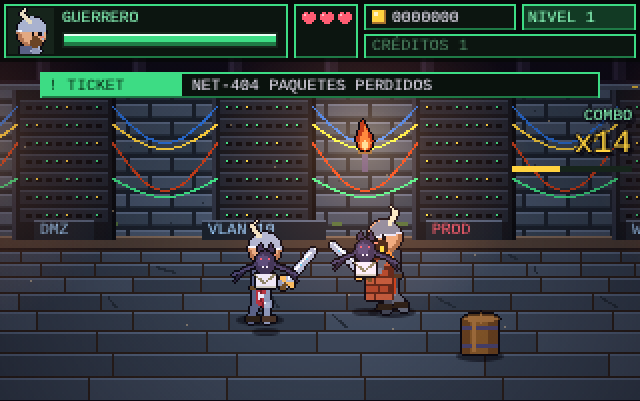
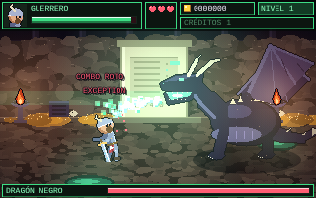
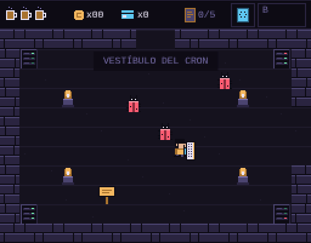

# Dungeons & Deployments

Beat 'em up de fantasía en pixel art en el que un equipo de desarrollo se abre camino por las catacumbas del CPD: de los goblins del ClickOps al Dragón Negro que custodia el AS/400.

Es un único archivo HTML con canvas y JavaScript, sin dependencias ni compilación. Se juega en el navegador, con teclado o con los mandos táctiles en el móvil.


## Jugar

- **Edición recreativa:** [`index.html`](index.html)
- **Versión clásica estilo Zelda:** [`zelda/index.html`](zelda/index.html)

Con GitHub Pages activado, el juego queda en `https://serbenda.github.io/dungeons-and-deployments/`.

Para jugar en local basta con abrir `index.html` en el navegador.

## Edición recreativa

Elige personaje y cierra los tickets de cada departamento hasta llegar a producción.

| Personaje | Estilo | Especial |
|---|---|---|
| **Guerrero de Rundeck** | Lento y pegón, espada con runas | `RUN JOB`: golpe al suelo que tumba a todos |
| **Mago Desarrollador** | Rápido, el remate lanza un `console.log()` | `GIT PUSH -F`: explosión arcana |


### Los departamentos

| Zona | Ticket | Enemigos |
|---|---|---|
| Sistemas | `SYS-101` Sala de guardia | Goblins del ClickOps, procesos zombi |
| Network | `NET-404` Paquetes perdidos | Murciélagos de paquetes perdidos, Caballero Firewall |
| Storage | `STO-100` Disco al 100% | Mímicos de disco lleno, fugas de memoria |
| Virtualización | `VIR-007` VMs huérfanas | VMs huérfanas fantasma, Gólem Hipervisor |
| CaaS | `K8S-503` CrashLoopBackOff | Pods que reaparecen hasta destruir el Deployment |
| Guarida | `INC-500` | El Dragón Negro del AS/400 |

| | |
|---|---|
|  |  |
|  |  |

### Controles

| Tecla | Acción |
|---|---|
| Flechas / WASD | Moverse (arriba y abajo para la profundidad) |
| Z · J · Espacio | Atacar (combo de 3), coger armas y comida |
| X · K | Saltar; atacar en el aire para la patada |
| C · L | Especial (cuesta 10 de vida) |
| Enter | Insertar crédito, empezar, pausa |
| M | Silenciar música y sonido |

Camina contra un enemigo para agarrarlo: dos rodillazos y al tercero lo lanzas contra los demás.

### Detalles

- Música chiptune propia para cada departamento y un tema para el jefe que acelera a media vida.
- Contador de combo con rangos: `NICE!`, `CLEAN CODE`, `10X DEVELOPER`, `SENIOR` y `ARQUITECTO`.
- Botín: poción de café, pollo asado, tortilla, bocata de calamares, Báculo de Ping, Martillo de Teclas, el patito de goma y el pergamino de Stack Overflow.
- Hay un código secreto en la pantalla de título. La marquesina da una pista.

## Versión clásica estilo Zelda

Aventura de 8 bits con vista cenital por las Catacumbas de Sistemas, con el Escudo de IaC (`plan` y `apply`), la Terminal SSH y el Grimorio de la Definition of Done.



| Tecla | Acción |
|---|---|
| Flechas / WASD | Moverse |
| Z · J · Espacio | Golpe de teclado, leer carteles |
| X · K | Terminal SSH |
| C · L | Escudo de IaC: mantener para `plan`, soltar para `apply` |
| Enter | Empezar, pasar textos y abrir el Grimorio |

## Estructura

```
index.html        Edición recreativa
zelda/index.html  Versión clásica estilo Zelda
docs/             Capturas
```
