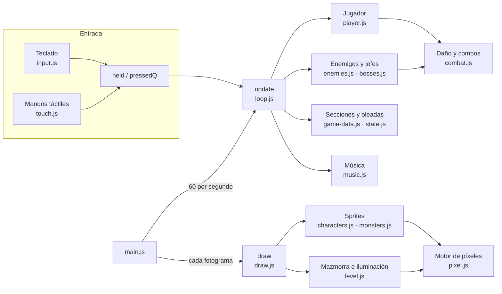
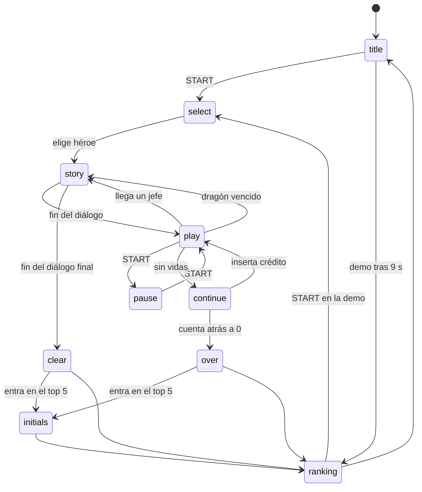

# Arquitectura

El juego es una web estática: HTML, CSS y JavaScript sin dependencias ni compilación. Todo (gráficos, música, mazmorra) se genera por código en el navegador.

## Visión general



## Carga de los scripts

`index.html` carga 21 scripts clásicos (no módulos ES) en un orden fijo. Comparten el ámbito global: lo que declara uno con `const`, `let` o `function` lo ven todos los demás.

Se eligieron scripts clásicos por dos motivos:

- Funcionan abriendo `index.html` directamente (`file://`), sin servidor. Los módulos ES no.
- No hace falta empaquetador: lo que está en el repositorio es exactamente lo que se publica.

La única regla es el **orden de carga**. Mientras un archivo se está cargando solo puede usar lo que declaran los anteriores. Dentro de funciones puede usar cualquier cosa, porque se ejecutan cuando ya está todo cargado. Por eso:

- `js/core/config.js` va el primero: canvas, resolución, paleta y la semilla opcional de `Math.random`.
- `js/main.js` va el último: es el único que arranca el bucle.
- `npm run lint` comprueba que `index.html` carga cada archivo de `js/` una sola vez, que `main.js` es el último y que el service worker precarga exactamente esos archivos.

Cada archivo empieza con `'use strict'` y una línea que resume su contenido.

## Mapa de archivos

| Archivo | Responsabilidad | Usa al cargarse |
|---|---|---|
| `core/config.js` | Canvas 320×200, límites del suelo (`FY0`, `FY1`), longitud de la etapa (`LEVEL_END`), paleta `C`, fuentes y semilla | — |
| `core/pixel.js` | `painter()`, `toCanvas()`, `sprite()` con caché, vectores `D()` y `add()` | `OUTLINE` |
| `sprites/characters.js` | Esqueletos (`RIGS`), poses (`POSES`), `paintRig()`, `getPose()`, `rigSprite()` | `pixel.js` |
| `sprites/monsters.js` | Gólem, dragón, slime, murciélago, fantasma, mímico, pod, tótem, objetos y llamas | `pixel.js` |
| `world/level.js` | Zonas (`ZONE`), antorchas, `buildLevel()`, `drawLevel()`, `drawLights()` | `config.js` |
| `data/game-data.js` | `HEROES`, `FOES`, `FOOD`, `SECTIONS`, `CRATES` | `LEVEL_END` |
| `audio/sfx.js` | `initAudio()` y `sfx()` | — |
| `audio/music.js` | Secuenciador `MUSIC` y `musicFor()` | — |
| `core/input.js` | Teclado, `held`, `pressedQ`, `press()`, `release()`, `pressed()`, código Konami | `cv` |
| `core/touch.js` | Cruceta analógica, botones táctiles, pantalla completa, vibración, pantalla encendida | `input.js` |
| `game/state.js` | Variables de la partida, `startGame()`, `mkFoe()`, `spawnWave()` | — |
| `core/utils.js` | Partículas, textos flotantes, colisiones, `GRUNTS`, `hostile()` | — |
| `game/combat.js` | `damage()` (combos), `damageRaw()` (bloqueos y derribos), `breakCrate()` | — |
| `entities/player.js` | Máquina de estados del jugador, agarres, armas y especiales | — |
| `entities/enemies.js` | IA genérica, murciélago, tótem, gólem, Dragón Negro, `stageClear()` | — |
| `entities/bosses.js` | Minotauro del Firewall e Hidra RAID | — |
| `ui/story.js` | Viñetas de historia | — |
| `ui/ranking.js` | Iniciales y ranking en `localStorage` | `localStorage` |
| `game/loop.js` | `update()` y `updatePlay()` | — |
| `render/draw.js` | Dibujo de actores, HUD y pantallas, `draw()` | — |
| `main.js` | Bucle `requestAnimationFrame`, modo `?debug`, registro del service worker | todo |

## Bucle principal

`main.js` usa un bucle de **paso fijo**:

```js
acc += Math.min(100, now - last);           // tiempo transcurrido (máx. 100 ms)
while (acc >= STEP_MS) { update(); acc -= STEP_MS; }   // 60 actualizaciones por segundo
draw();                                      // un dibujo por fotograma de pantalla
```

La lógica avanza siempre a 60 actualizaciones por segundo, aunque la pantalla vaya a 30, 60 o 144 Hz. Todas las duraciones del código (`wind`, `inv`, `cool`, `t`...) se cuentan en **actualizaciones**: 60 equivalen a un segundo.

Hay tres mecanismos que alteran el paso del tiempo dentro de `updatePlay()`:

- `hitstop`: congela unas actualizaciones al golpear, para dar sensación de impacto.
- `slowmo`: cámara lenta (solo una de cada tres actualizaciones) al vencer al dragón.
- `state = 'story'` o `'pause'`: la partida se detiene por completo.

## Máquina de estados

La variable global `state` decide qué hace `update()` y qué dibuja `draw()`:



| Estado | Actualiza | Dibuja |
|---|---|---|
| `title` | Espera START; a los 9 s pasa a la demo del ranking | `drawTitle()` |
| `select` | Elección de héroe | `drawSelect()` |
| `story` | `updateStory()` | Partida congelada + `drawStory()` |
| `play` | `updatePlay()` | Partida |
| `pause` | Espera START | Partida + PAUSA |
| `continue` | Cuenta atrás de ¿ROLLBACK? | Partida + cuenta atrás |
| `over` / `clear` | Espera START y llama a `afterRun()` | Partida + resultados |
| `initials` | `updateInitials()` | Partida + ¡NUEVO RÉCORD! |
| `ranking` | `updateRanking()` | `drawRanking()` |

## Coordenadas y cámara

```
        x →  (mundo: 0 … LEVEL_END + 320)
   ┌──────────────────────────────────────┐ y = 0
   │  HUD (31 px)                         │
   │  pared, decorado                     │
   ├──────────────────────────────────────┤ y = FY0 (128)  ← fondo del suelo
   │  suelo: los actores se mueven aquí   │
   ├──────────────────────────────────────┤ y = FY1 (190)  ← primer plano
   └──────────────────────────────────────┘ y = 200
```

- **x**: posición horizontal en el mundo. La cámara (`camX`) es la x del borde izquierdo de la pantalla y solo avanza. Al llegar a la `cam` de una sección se bloquea hasta limpiarla.
- **y**: profundidad sobre el suelo, entre `FY0` y `FY1`. Dos actores solo se golpean si su `y` es parecida (`inFront()` admite 9 píxeles de tolerancia). Los actores se dibujan ordenados por `y`, de fondo a primer plano.
- **z**: altura sobre el suelo (saltos, vuelo, derribos). Se dibuja restando `z` a `y`.
- **face**: `1` mira a la derecha y `-1` a la izquierda. Los sprites se pintan mirando a la derecha y se voltean al dibujarlos.

## Actores

Todos los actores son objetos planos con, al menos, `kind`, `x`, `y`, `z`, `hp`, `max`, `state`, `t` (actualizaciones en el estado actual) y `face`. El jugador es `P`, los enemigos están en `foes`, las cajas en `crates`, los objetos del suelo en `items` y los proyectiles en `shots` (del jugador) y `eshots` (de enemigos).

Cada actor tiene su propia máquina de estados en un `switch (e.state)`. Los estados más comunes son `walk`, `windup` (preparando un golpe), `attack`, `hurt`, `down` (derribado; `lying` indica que ya ha caído) y `getup`.

## Secciones

La etapa es una lista de secciones (`SECTIONS` en `data/game-data.js`). Cuando `camX` alcanza la `cam` de la siguiente sección, `updatePlay()`:

1. Bloquea la cámara (`locked = true`) y muestra el ticket `mission`.
2. Crea los elementos fijos de la sección: gólem, mímicos o tótem.
3. Lanza la primera oleada con `spawnWave()`.
4. Cuando `hostile()` queda vacío, lanza la siguiente oleada.
5. Después de la última, si hay `miniboss`, lo crea con su diálogo.
6. Cuando todo está limpio, muestra `close`, desbloquea la cámara y aparece «GO!».

La última sección (`boss: true`) crea el Dragón Negro. Al vencerlo, el diálogo final da paso a `stageClear()`.

## Persistencia

Solo se guarda en el navegador:

| Clave de `localStorage` | Contenido |
|---|---|
| `dnd-arcade-ranking` | Top 5 de iniciales y puntos (JSON) |
| `dnd-arcade-best` | Mejor puntuación (compatibilidad con versiones anteriores) |

Todos los accesos van en `try/catch`: en modo incógnito o con el almacenamiento bloqueado el juego funciona igual, sin guardar.
