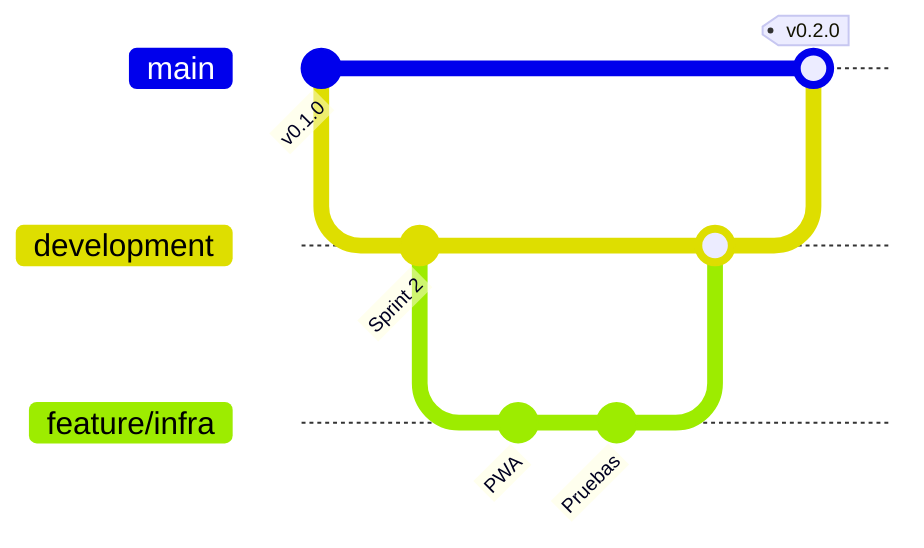
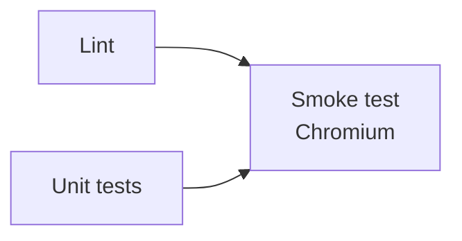

# Despliegue y versiones

## Ramas



| Rama | Para qué | Cómo entra el código |
|---|---|---|
| `main` | Lo publicado en GitHub Pages | PR desde `development`, con la CI en verde |
| `development` | Integración | PR desde `feature/*`, `fix/*` o `docs/*` |
| `feature/*`, `fix/*`, `docs/*` | Un cambio concreto | Commits |

Se recomienda proteger `main` y `development` en *Settings → Branches*: exigir PR y que pasen los jobs **Lint**, **Unit tests**, **Smoke test (Chromium)**, **Smoke test (Firefox)** y **Smoke test (WebKit / Safari)**.

## Integración continua

`.github/workflows/ci.yml` (workflow **CI**) se ejecuta en cada push a `main` y `development` y en cada Pull Request:



- **Lint** y **Unit tests** corren en paralelo.
- **Smoke test (Chromium)** solo corre si los dos pasan: todas las partidas, con tres semillas.
- **Smoke test (Firefox)** y **Smoke test (WebKit / Safari)** corren a la vez que el de Chromium, con una selección corta (`QUICK=1`, una semilla).
- Un push nuevo a la misma rama cancela la ejecución anterior.

## Publicación en GitHub Pages

`.github/workflows/pages.yml` (workflow **Deploy to GitHub Pages**) se ejecuta en cada push a `main` (y a mano con *Run workflow*):

1. Copia a `_site/` solo lo que se publica: `index.html`, `manifest.webmanifest`, `sw.js`, `css/`, `js/` e `img/`. Ni pruebas, ni herramientas, ni documentación.
2. Lo sube como artefacto y lo despliega en Pages.

Configuración (una vez): *Settings → Pages → Build and deployment → Source: GitHub Actions*.

El juego queda en `https://serbenda.github.io/dungeons-and-deployments/`. Todas las rutas son relativas, así que funciona igual bajo esa subruta, en un dominio propio o en local.

## La caché de la PWA

`sw.js` guarda los archivos para jugar sin conexión con dos estrategias:

| Recurso | Estrategia | Motivo |
|---|---|---|
| Archivos propios | **Primero la red**, y la caché si no hay conexión | Con conexión siempre se juega la última versión; nunca se queda una antigua |
| Fuentes de Google | **Primero la caché** | No cambian; se guardan la primera vez y funcionan sin conexión desde entonces |

Al instalarse, precarga la lista `ASSETS`. Al activarse una versión nueva, borra las cachés de versiones anteriores.

Al publicar una versión con archivos nuevos o renombrados:

1. Actualiza `ASSETS` (`npm run lint` avisa si no coincide con `index.html`).
2. Sube `CACHE_VERSION`.

## Publicar una versión

1. En `development`, mueve las entradas de «Sin publicar» del `CHANGELOG.md` a una versión nueva con fecha.
2. Sube la versión en `package.json` y `CACHE_VERSION` en `sw.js`. Se sigue el [versionado semántico](https://semver.org/lang/es/): nuevas funcionalidades suben la versión menor (0.**3**.0); arreglos, la de parche (0.3.**1**).
3. Abre la PR de `development` a `main` y fusiónala con la CI en verde.
4. Crea la etiqueta y la release en GitHub:
   ```bash
   git checkout main && git pull
   git tag -a v0.3.0 -m "v0.3.0"
   git push origin v0.3.0
   ```
   En *Releases → Draft a new release*, elige la etiqueta y pega las notas del `CHANGELOG`.

## Dependencias

`.github/dependabot.yml` revisa cada lunes las acciones de GitHub Actions y las dependencias de desarrollo de npm, y abre PRs agrupadas contra `development`. El juego en sí no tiene dependencias: npm solo se usa para ESLint y Playwright.
