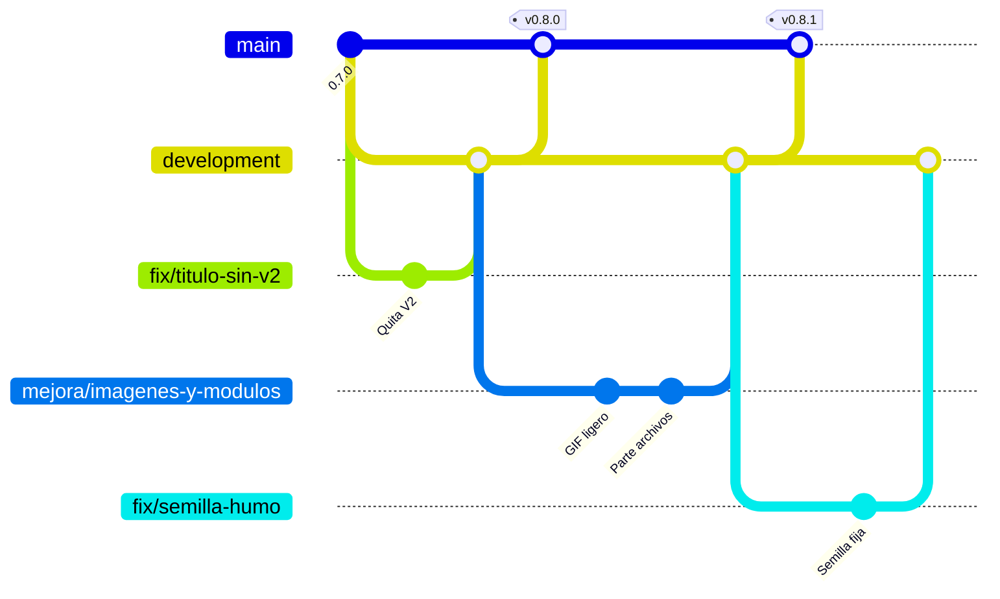
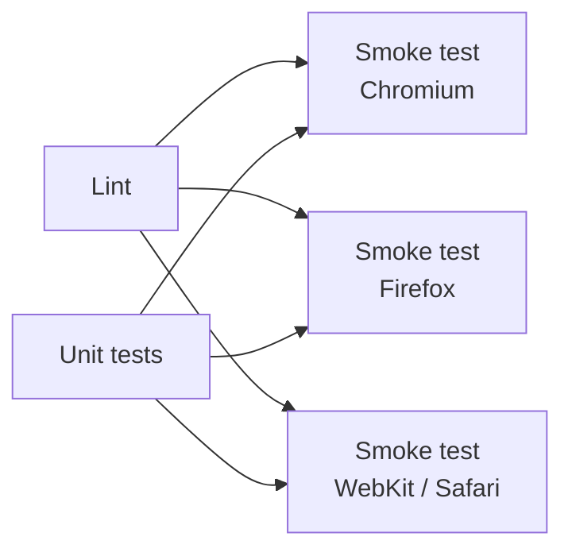

# Despliegue y versiones

## Ramas



Así se publicaron la 0.8.0 y la 0.8.1. Lo que entra en `development` después de la última release (aquí, `fix/semilla-humo`) espera a la siguiente versión.

| Rama | Para qué | Cómo entra el código |
|---|---|---|
| `main` | Lo publicado en GitHub Pages | PR desde `development`, con la CI en verde |
| `development` | Integración: lo que irá en la próxima versión | PR desde `feature/*`, `fix/*`, `mejora/*` o `docs/*`, con la CI en verde |
| `feature/*`, `fix/*`, `mejora/*`, `docs/*` | Un cambio concreto | Commits |

### Protección de ramas

`main` y `development` están protegidas con la regla **Protect main and development** (*Settings → Rules → Rulesets*):

| Regla | Efecto |
|---|---|
| Require a pull request before merging | No se puede hacer push directo: todo entra por PR. Aprobaciones requeridas: **0**, para poder fusionar las PR propias trabajando solo |
| Require status checks to pass | La PR solo se puede fusionar con **Lint**, **Unit tests**, **Smoke test (Chromium)**, **Smoke test (Firefox)** y **Smoke test (WebKit / Safari)** en verde |
| Require conversation resolution | Los comentarios de revisión tienen que estar resueltos |
| Block force pushes | Nadie puede reescribir el historial publicado |
| Restrict deletions | Las ramas no se pueden borrar |

No hay excepciones (*bypass list* vacía): la regla también se aplica al propietario del repositorio. Si una PR no se puede fusionar, mira qué check ha fallado en la pestaña *Checks*.

## Integración continua

`.github/workflows/ci.yml` (workflow **CI**) se ejecuta en cada push a `main` y `development` y en cada Pull Request:



| Job | Qué hace | Tiempo aproximado |
|---|---|---|
| **Lint** | `npm run lint:project` y `npm run lint:js` | < 1 min |
| **Unit tests** | `npm test` (53 pruebas) | < 1 min |
| **Smoke test (Chromium)** | `npm run test:e2e` con `SEEDS=1,2,3`: todas las partidas | ~2 min |
| **Smoke test (Firefox)** | La selección corta (`QUICK=1`, `SEEDS=1`), servida por http | ~1 min |
| **Smoke test (WebKit / Safari)** | Igual, en WebKit | ~3 min |

- **Lint** y **Unit tests** corren en paralelo.
- **Smoke test (Chromium)** solo corre si los dos pasan: todas las partidas, con tres semillas.
- **Smoke test (Firefox)** y **Smoke test (WebKit / Safari)** también esperan a Lint y Unit tests, y corren a la vez que el de Chromium, con una selección corta (`QUICK=1`, una semilla). Se sirven por http (`python3 -m http.server 8000` y `BASE_URL=http://localhost:8000/`), como en GitHub Pages: con `file://`, WebKit bloquea las fuentes de otro origen y lo cuenta como error de consola.
- Si una prueba de humo falla, el job muestra el motivo como anotación (`::error`) en el resumen de la ejecución, con la URL para reproducirlo.
- Un push nuevo a la misma rama cancela la ejecución anterior.

## Publicación en GitHub Pages

`.github/workflows/pages.yml` (workflow **Deploy to GitHub Pages**) se ejecuta en cada push a `main` (y a mano con *Run workflow*):

1. Copia a `_site/` solo lo que se publica: `index.html`, `manifest.webmanifest`, `sw.js`, `css/`, `js/` e `img/`. Ni pruebas, ni herramientas, ni documentación.
2. Lo sube como artefacto y lo despliega en Pages.

Configuración (una vez): *Settings → Pages → Build and deployment → Source: GitHub Actions*.

El juego queda en `https://serbenda.github.io/dungeons-and-deployments/`. Todas las rutas son relativas, así que funciona igual bajo esa subruta, en un dominio propio o en local.

## La caché de la PWA

`sw.js` guarda los archivos para jugar sin conexión con dos estrategias:

| Recurso | Estrategia | Motivo |
|---|---|---|
| Archivos propios | **Primero la red**, y la caché si no hay conexión | Con conexión siempre se juega la última versión; nunca se queda una antigua |
| Fuentes de Google | **Primero la caché** | No cambian; se guardan la primera vez y funcionan sin conexión desde entonces |

Al instalarse, precarga la lista `ASSETS`. Al activarse una versión nueva, borra las cachés de versiones anteriores.

Al publicar una versión con archivos nuevos o renombrados:

1. Actualiza `ASSETS` (`npm run lint` avisa si no coincide con `index.html`).
2. Sube `CACHE_VERSION`.

## Publicar una versión

1. En una rama desde `development`, mueve las entradas de «Sin publicar» del `CHANGELOG.md` a una versión nueva con fecha.
2. Sube la versión en `package.json` y `CACHE_VERSION` en `sw.js`. Se sigue el [versionado semántico](https://semver.org/lang/es/): nuevas funcionalidades suben la versión menor (0.**9**.0); arreglos y cambios internos, la de parche (0.8.**2**).
3. Fusiona esa rama en `development` por PR y, después, abre la PR de `development` a `main`. Al fusionarla con la CI en verde se publica en GitHub Pages.
4. Crea la release. La forma más sencilla es desde la web: *Releases → Draft a new release*, escribe la etiqueta nueva (`v0.9.0`), elige como *Target* el commit de fusión en `main`, pon la etiqueta como título y pega las notas de esa versión del `CHANGELOG`. GitHub crea la etiqueta al publicar. Desde la terminal sería:
   ```bash
   git checkout main && git pull
   gh release create v0.9.0 --target main --title v0.9.0 --notes-file notas.md
   ```

Si una versión nunca llegó a `main` por separado (porque se publicó junto con la siguiente), no tiene release propia: sus notas van en la release de la versión que la incluye.

### Releases publicadas

| Release | Commit en `main` | Incluye |
|---|---|---|
| [v0.8.1](https://github.com/serbenda/dungeons-and-deployments/releases/tag/v0.8.1) | `8075cf5` | GIF y capturas más ligeros; jefes y dibujo repartidos en archivos |
| [v0.8.0](https://github.com/serbenda/dungeons-and-deployments/releases/tag/v0.8.0) | `2d3ebf7` | Avisos grandes, CI en Firefox y WebKit, Kraken con *taint*, textos de la página |
| [v0.7.0](https://github.com/serbenda/dungeons-and-deployments/releases/tag/v0.7.0) | `4f9e453` | Partida guardada |
| [v0.6.0](https://github.com/serbenda/dungeons-and-deployments/releases/tag/v0.6.0) | `cdc5864` | Etapa 3 (La Nube) y la 0.5.0: modo jefes y teclas reasignables |
| [v0.4.0](https://github.com/serbenda/dungeons-and-deployments/releases/tag/v0.4.0) | `db6538a` | Etapa 2 (Las Cuevas) y la 0.3.0: cooperativo, mandos, héroes nuevos, El Revisor, opciones y logros |
| [v0.2.0](https://github.com/serbenda/dungeons-and-deployments/releases/tag/v0.2.0) | `2cb9c05` | Jefes de la etapa 1, historia, ranking, móvil, PWA, pruebas y CI |
| [v0.1.0](https://github.com/serbenda/dungeons-and-deployments/releases/tag/v0.1.0) | `6563dfa` | Primera versión |

## Dependencias

`.github/dependabot.yml` revisa cada lunes las acciones de GitHub Actions y las dependencias de desarrollo de npm, y abre PRs agrupadas contra `development`. El juego en sí no tiene dependencias: npm solo se usa para ESLint y Playwright.
